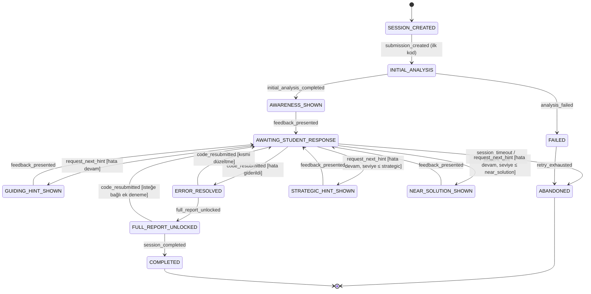
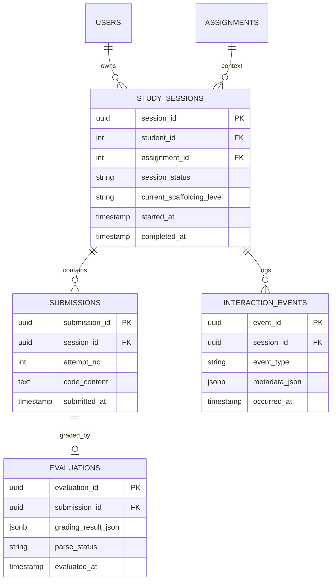

# Sokratik Akış ve Veri Sözleşmesi — Teknik Tasarım Dokümanı

**Proje:** CodeGradeAI v0.2  
**Faz:** 2.1 — Kademeli Sokratik İskeleleme ve Öz-Düzeltme Döngüsü  
**Araştırma:** YAYIN_016 (öğrenci verisine dayalı etkililik / öğrenme analitiği)  
**Durum:** Tasarım donduruldu (Faz 3 veritabanı ve Faz 4 arayüz geliştirmesi öncesi)  
**İlişkili dokümanlar:** `CodeGradeAI_v0_2_Gelistirme_Hedefleri.md`, `DEVELOPER_NOTES.md` (Faz 1–2), `backend/app/schemas.py`

---

## 1. Amaç ve Kapsam

Bu doküman, CodeGradeAI'de **Kademeli Sokratik İskeleleme ve Öz-Düzeltme Döngüsü** için durum (state), olay (event) ve veri varlığı (entity) sözleşmesini tanımlar. Amaç, YAYIN_016 araştırmasında izlenebilir, tekrarlanabilir ve pedagojik olarak tutarlı bir müdahale akışının Faz 3 (PostgreSQL) ve Faz 4 (frontend) uygulamalarına rehberlik etmesidir.

**Kapsam dışı:** Bu doküman uygulama kodu, migration script'i veya SQL DDL içermez. Yalnızca mimari sözleşmeyi dondurur.

### 1.1 Pedagojik İlke Özeti

Sistem, öğrenciye doğrudan çalışan kod veya cevap anahtarı vermeden; hatayı fark ettiren sorular, yönlendirici ipuçları ve stratejik yönlendirmelerle **öz-düzeltme döngüsünü** destekler. Her oturum, tek seferlik puanlama yerine çok turlu etkileşim olarak modellenir.

---

## 2. Mimari Kural (Zorunlu)

> **Durum (State) geçişleri yalnızca Backend tarafından kontrol edilir. Frontend doğrudan seviye atlatamaz. AI promptlarındaki `NO DIRECT CODE IN HINTS` kuralı mimarinin temel pedagojik kısıtlamasıdır.**

### 2.1 Backend Tek Yetkili Otorite

| Katman | İzin verilen | Yasak |
| :--- | :--- | :--- |
| **Backend (State Machine)** | Oturum durumu güncelleme, iskeleleme seviyesi ilerletme/dondurma, tam rapor kilidi açma, oturumu sonlandırma | — |
| **Frontend** | Mevcut duruma uygun UI gösterme, öğrenci yanıtı/kod gönderme isteği başlatma, olay tetikleyici API çağrıları | `current_scaffolding_level` veya `session_status` alanlarını doğrudan yazma; istemci tarafında seviye atlama |
| **AI Servisi** | Verilen seviyeye uygun Sokratik geri bildirim üretme | Oturum durumunu belirleme; seviye atlatma kararı verme |

Frontend yalnızca **niyet bildirir** (ör. `request_next_hint`, `submit_revised_code`). Geçerli geçiş kararı backend state machine tarafından verilir ve `interaction_events` tablosuna kaydedilir.

### 2.2 NO DIRECT CODE IN HINTS

- AI prompt sözleşmesinde (`cgai_prompt_v0.2`) tanımlı **tam çözüm yasağı** mimari düzeyde korunur.
- `SocraticFeedback.direct_solution_given = true` üretildiğinde backend olayı `direct_solution_violation_detected` olarak loglar; pedagojik denetim ve YAYIN_016 analizi için işaretlenir.
- `near_solution` seviyesi bile doğrudan kopyalanabilir kod bloğu içermez; yalnızca strateji, pseudocode veya kavramsal yönlendirme içerebilir.

---

## 3. Durumlar (States)

### 3.1 Oturum Durumları (`session_status`)

Oturum durumları, bir öğrencinin belirli bir ödev bağlamındaki **çalışma oturumunun** yaşam döngüsünü tanımlar. Durum adları büyük harf snake_case ile sabitlenmiştir.

| Durum | Açıklama | `current_scaffolding_level` |
| :--- | :--- | :--- |
| `SESSION_CREATED` | Oturum kaydı oluşturuldu; henüz kod gönderilmedi | `null` |
| `INITIAL_ANALYSIS` | İlk kod teslimi alındı; AI ilk değerlendirme üretiyor veya üretildi | `awareness` (hedef) |
| `AWARENESS_SHOWN` | Farkındalık sorusu / ilk Sokratik geri bildirim öğrenciye sunuldu | `awareness` |
| `AWAITING_STUDENT_RESPONSE` | Öğrenciden yanıt veya kod revizyonu bekleniyor | Mevcut seviye korunur |
| `GUIDING_HINT_SHOWN` | Yönlendirici (guided) ipucu sunuldu | `guided_hint` |
| `STRATEGIC_HINT_SHOWN` | Stratejik ipucu sunuldu | `strategic_hint` |
| `NEAR_SOLUTION_SHOWN` | Çözüme yakın (near_solution) ipucu sunuldu | `near_solution` |
| `ERROR_RESOLVED` | Öğrenci revize kodu ile hata giderildi; backend doğruladı | Önceki seviye veya `null` |
| `FULL_REPORT_UNLOCKED` | Tam rubrik, hata taksonomisi ve nihai puan raporu açıldı | Son ulaşılan seviye |
| `COMPLETED` | Oturum başarıyla tamamlandı (rapor görüntülendi veya son teslim kabul edildi) | Son ulaşılan seviye |
| `ABANDONED` | Zaman aşımı, öğrenci çıkışı veya öğretmen müdahalesi ile yarım bırakıldı | Dondurulmuş son seviye |
| `FAILED` | Sistem/AI hatası nedeniyle oturum ilerleyemedi | Değişmez |

### 3.2 İskeleleme Seviyeleri (`current_scaffolding_level`)

Faz 1–2 şema sözleşmesi ile hizalı sabit değerler (`ScaffoldingLevel`):

```text
awareness → guided_hint → strategic_hint → near_solution
```

Bu alan oturumun **o anki pedagojik derinliğini** gösterir; durum makinesi ile birlikte ilerler ancak birebir eş değer değildir (ör. `AWAITING_STUDENT_RESPONSE` durumunda seviye sabit kalabilir).

### 3.3 İzin Verilen Durum Geçişleri

Aşağıdaki diyagram geçerli geçişleri gösterir. Kesikli oklar istisnai veya koşullu geçişleri temsil eder.



### 3.4 Geçiş Kuralları (Backend Doğrulama)

| Kural ID | Kural |
| :--- | :--- |
| **G-01** | İskeleleme seviyesi yalnızca sıralı ilerleyebilir: `awareness` → `guided_hint` → `strategic_hint` → `near_solution`. Atlama yasaktır. |
| **G-02** | `request_next_hint` yalnızca `AWAITING_STUDENT_RESPONSE` durumunda ve önceki ipucu sunulmuş olması koşuluyla kabul edilir. |
| **G-03** | `ERROR_RESOLVED` geçişi, yeni teslimde AI değerlendirmesinin `blocking`/`high` severity hatalarının giderildiğini backend'in doğrulamasını gerektirir. |
| **G-04** | `FULL_REPORT_UNLOCKED` yalnızca `ERROR_RESOLVED` sonrasında veya öğretmen/araştırma protokolü gereği erken kilitleme bayrağı ile tetiklenir. |
| **G-05** | `COMPLETED` yalnızca `FULL_REPORT_UNLOCKED` sonrasında mümkündür. |
| **G-06** | Frontend'den gelen herhangi bir `scaffolding_level` veya `session_status` alanı istek gövdesinde **yok sayılır**; yalnızca backend hesaplar. |
| **G-07** | Maksimum ipucu turu sayısı (ör. 4 seviye) ve oturum süresi backend yapılandırması ile sınırlandırılabilir; limit aşımında `ABANDONED` veya `FULL_REPORT_UNLOCKED` (protokole göre). |

---

## 4. Olaylar (Events)

Tüm olaylar `interaction_events` tablosuna append-only (ekleme odaklı) olarak yazılır. Olay adları küçük harf snake_case ile sabitlenmiştir.

### 4.1 Oturum Yaşam Döngüsü Olayları

| Olay | Tetikleyici | `metadata_json` örnek alanları |
| :--- | :--- | :--- |
| `session_started` | Öğrenci ödev bağlamında yeni oturum açtı | `assignment_id`, `student_level`, `research_consent` |
| `session_resumed` | Mevcut oturuma geri dönüldü | `previous_status`, `elapsed_ms` |
| `session_completed` | Oturum `COMPLETED` durumuna geçti | `total_attempts`, `final_grade`, `duration_ms` |
| `session_abandoned` | Oturum yarım bırakıldı | `reason` (`timeout`, `student_exit`, `teacher_override`) |
| `session_failed` | Sistem hatası | `error_code`, `error_message` (PII içermez) |

### 4.2 Teslim ve Değerlendirme Olayları

| Olay | Tetikleyici | `metadata_json` örnek alanları |
| :--- | :--- | :--- |
| `submission_created` | Yeni kod teslimi kaydedildi | `submission_id`, `attempt_no`, `code_hash`, `line_count` |
| `initial_analysis_completed` | İlk AI değerlendirmesi tamamlandı | `evaluation_id`, `grade`, `error_count`, `latency_ms` |
| `analysis_completed` | Herhangi bir deneme için AI değerlendirmesi tamamlandı | `evaluation_id`, `attempt_no`, `grade_delta` |
| `analysis_failed` | AI çağrısı veya parse hatası | `evaluation_id`, `parse_status`, `retry_count` |

### 4.3 Sokratik İskeleleme Olayları

| Olay | Tetikleyici | `metadata_json` örnek alanları |
| :--- | :--- | :--- |
| `awareness_hint_shown` | Farkındalık geri bildirimi sunuldu | `scaffolding_level`, `evaluation_id` |
| `guiding_hint_requested` | Öğrenci/ sistem bir sonraki yönlendirici ipucunu istedi | `from_level`, `requested_by` (`student`, `system`) |
| `guiding_hint_shown` | Yönlendirici ipucu sunuldu | `scaffolding_level`, `evaluation_id` |
| `strategic_hint_requested` | Stratejik ipucu isteği | `from_level` |
| `strategic_hint_shown` | Stratejik ipucu sunuldu | `scaffolding_level`, `evaluation_id` |
| `near_solution_hint_shown` | Near-solution ipucu sunuldu | `scaffolding_level`, `evaluation_id` |
| `scaffolding_level_advanced` | Backend seviyeyi resmen ilerletti | `from_level`, `to_level`, `trigger_event` |
| `feedback_presented` | Geri bildirim UI'da gösterildi (sunum onayı) | `presentation_ms`, `blocks_shown` |

### 4.4 Öz-Düzeltme Döngüsü Olayları

| Olay | Tetikleyici | `metadata_json` örnek alanları |
| :--- | :--- | :--- |
| `student_response_submitted` | Öğrenci Sokratik soruya metin yanıtı gönderdi | `response_length`, `question_type` |
| `code_resubmitted` | Öğrenci revize kod gönderdi | `submission_id`, `attempt_no`, `lines_changed` |
| `error_resolved` | Backend hata giderimini doğruladı | `resolved_error_types`, `remaining_errors` |
| `error_persisted` | Revize sonrası hata devam ediyor | `persisted_error_types`, `severity_max` |
| `full_report_unlocked` | Tam değerlendirme raporu açıldı | `unlock_reason`, `final_grade` |

### 4.5 Pedagojik Denetim Olayları

| Olay | Tetikleyici | `metadata_json` örnek alanları |
| :--- | :--- | :--- |
| `direct_solution_violation_detected` | AI `direct_solution_given=true` döndürdü | `evaluation_id`, `scaffolding_level`, `prompt_version` |
| `hint_content_flagged` | İpucu metni otomatik/manual inceleme bayrağı aldı | `flag_reason`, `reviewer_id` (varsa) |

### 4.6 Olay Sözleşmesi Kuralları

| Kural ID | Kural |
| :--- | :--- |
| **E-01** | Her olay `session_id` ile ilişkilendirilir; mümkünse `submission_id` ve/veya `evaluation_id` referansı taşır. |
| **E-02** | Olaylar silinmez veya güncellenmez; düzeltme gerekiyorsa telafi edici olay eklenir. |
| **E-03** | `metadata_json` kişisel veri (ad, e-posta, öğrenci numarası) içermez; YAYIN_016 export'unda doğrudan kullanılabilir. |
| **E-04** | Durum geçişi gerçekleştiğinde hem geçiş olayı (`scaffolding_level_advanced` vb.) hem de hedef duruma özgü olay (`guiding_hint_shown` vb.) loglanabilir; ikisi `metadata_json.trigger_event` ile ilişkilendirilir. |

---

## 5. Veri Varlıkları (Data Entities)

Faz 3'te PostgreSQL'de oluşturulacak dört temel tablo aşağıda tanımlanmıştır. Mevcut MVP `submissions` tablosu (`backend/app/models.py`) korunabilir; yeni model oturum merkezli genişletmedir.

### 5.1 Varlık İlişki Diyagramı



### 5.2 Çalışma Oturumu — `study_sessions`

Bir öğrencinin bir ödevdeki Sokratik çalışma birimini temsil eder.

| Alan | Tür | Zorunlu | Açıklama |
| :--- | :--- | :---: | :--- |
| `session_id` | UUID | ✓ | Birincil anahtar |
| `student_id` | INTEGER (FK → `users.id`) | ✓ | Oturum sahibi öğrenci |
| `assignment_id` | INTEGER (FK → `assignments.id`) | ✓ | Ödev bağlamı |
| `organization_id` | INTEGER (FK → `organizations.id`) | ✓ | Çok kiracılı izolasyon |
| `session_status` | VARCHAR(32) | ✓ | Bölüm 3.1 durum enum'u |
| `current_scaffolding_level` | VARCHAR(32) | — | `awareness` \| `guided_hint` \| `strategic_hint` \| `near_solution` \| NULL |
| `attempt_count` | INTEGER | ✓ | Toplam kod teslim sayısı (denormalize, hızlı sorgu) |
| `max_scaffolding_level_reached` | VARCHAR(32) | — | Oturum boyunca ulaşılan en yüksek seviye |
| `research_pseudonym` | VARCHAR(64) | — | YAYIN_016 anonim/export kimliği (PII değil) |
| `student_level` | VARCHAR(16) | ✓ | `beginner` \| `intermediate` \| `advanced` (oturum anında snapshot) |
| `started_at` | TIMESTAMPTZ | ✓ | Oturum başlangıcı |
| `last_activity_at` | TIMESTAMPTZ | ✓ | Son etkileşim (timeout için) |
| `completed_at` | TIMESTAMPTZ | — | `COMPLETED` anı |
| `final_grade` | SMALLINT | — | 0–100; `FULL_REPORT_UNLOCKED` sonrası |
| `full_report_unlocked_at` | TIMESTAMPTZ | — | Tam rapor açılış zamanı |
| `consent_recorded` | BOOLEAN | ✓ | Araştırma onam bayrağı |
| `created_at` | TIMESTAMPTZ | ✓ | Kayıt oluşturma |
| `updated_at` | TIMESTAMPTZ | ✓ | Son backend güncellemesi |

**Benzersizlik önerisi:** `(student_id, assignment_id)` için aktif oturum başına bir kayıt (`session_status NOT IN ('COMPLETED','ABANDONED','FAILED')` kısıtı uygulama katmanında veya partial unique index ile).

### 5.3 Kod Denemeleri — `submissions` (genişletilmiş)

Her kod gönderimi bir oturuma bağlı ayrı deneme kaydıdır. MVP'deki mevcut tablo bu sözleşmeye evrilir.

| Alan | Tür | Zorunlu | Açıklama |
| :--- | :--- | :---: | :--- |
| `submission_id` | UUID | ✓ | Birincil anahtar (MVP `id` ile eşleme veya yeni sütun) |
| `session_id` | UUID (FK → `study_sessions.session_id`) | ✓ | Bağlı oturum |
| `student_id` | INTEGER (FK → `users.id`) | ✓ | Denormalize sa sahip (sorgu kolaylığı) |
| `assignment_id` | INTEGER (FK → `assignments.id`) | ✓ | Denormalize ödev |
| `attempt_no` | INTEGER | ✓ | Oturum içi sıra (1 = ilk teslim) |
| `code_content` | TEXT | ✓ | Öğrenci kaynak kodu |
| `code_hash` | VARCHAR(64) | — | SHA-256; değişiklik analizi için |
| `code_language` | VARCHAR(32) | ✓ | Ödev dilinden snapshot |
| `submitted_at` | TIMESTAMPTZ | ✓ | Teslim zamanı |
| `submission_source` | VARCHAR(16) | ✓ | `initial` \| `revision` \| `teacher_forced` |
| `is_final` | BOOLEAN | ✓ | Oturum kapanış teslimi mi |
| `created_at` | TIMESTAMPTZ | ✓ | Kayıt oluşturma |

**Not:** MVP'deki `grading_result` JSON alanı bu tabloda tutulmaz; normalize edilmiş `evaluations` tablosuna taşınır. Geriye uyumluluk için geçiş döneminde nullable mirror alan bırakılabilir (Faz 3 uygulama kararı).

### 5.4 AI Değerlendirmeleri — `evaluations`

Her teslim için üretilen AI değerlendirme çıktısının immutable kaydı.

| Alan | Tür | Zorunlu | Açıklama |
| :--- | :--- | :---: | :--- |
| `evaluation_id` | UUID | ✓ | Birincil anahtar |
| `submission_id` | UUID (FK → `submissions.submission_id`) | ✓ | Değerlendirilen teslim |
| `session_id` | UUID (FK → `study_sessions.session_id`) | ✓ | Denormalize oturum referansı |
| `grading_result_json` | JSONB | ✓ | Tam `GradingResult` sözleşmesi (Faz 2) |
| `grade` | SMALLINT | ✓ | 0–100 (`grading_result_json.grade` mirror) |
| `scaffolding_level` | VARCHAR(32) | ✓ | Bu değerlendirmede uygulanan seviye |
| `feedback_strategy` | VARCHAR(32) | ✓ | `socratic_scaffolding` |
| `prompt_version` | VARCHAR(32) | ✓ | örn. `cgai_prompt_v0.2` |
| `rubric_version` | VARCHAR(32) | ✓ | örn. `cgai_rubric_v0.2` |
| `model_name` | VARCHAR(64) | — | Kullanılan LLM |
| `direct_solution_given` | BOOLEAN | ✓ | Pedagojik denetim bayrağı |
| `error_types_json` | JSONB | — | `errorFindings[].error_type` dizisi |
| `rubric_scores_json` | JSONB | — | `rubricScores` mirror |
| `socratic_feedback_json` | JSONB | — | `socraticFeedback` mirror |
| `raw_ai_response_json` | JSONB | — | Ham model yanıtı (araştırma/debug) |
| `parse_status` | VARCHAR(16) | ✓ | `success` \| `partial` \| `fallback` \| `failed` |
| `latency_ms` | INTEGER | — | AI çağrı süresi |
| `evaluated_at` | TIMESTAMPTZ | ✓ | Değerlendirme tamamlanma |
| `created_at` | TIMESTAMPTZ | ✓ | Kayıt oluşturma |

**`grading_result_json` beklenen üst düzey yapı** (Faz 1–2 ile hizalı):

```text
grade, feedback, codeQuality, suggestions, unitTests
rubricScores, errorFindings, socraticFeedback, pedagogicalMetadata
```

### 5.5 Etkileşim Olayları — `interaction_events`

YAYIN_016 öğrenme analitiği için append-only olay günlüğü.

| Alan | Tür | Zorunlu | Açıklama |
| :--- | :--- | :---: | :--- |
| `event_id` | UUID | ✓ | Birincil anahtar |
| `session_id` | UUID (FK → `study_sessions.session_id`) | ✓ | Olayın ait olduğu oturum |
| `event_type` | VARCHAR(64) | ✓ | Bölüm 4 olay enum'u |
| `event_sequence` | INTEGER | ✓ | Oturum içi monoton sıra |
| `submission_id` | UUID (FK) | — | İlgili teslim (varsa) |
| `evaluation_id` | UUID (FK) | — | İlgili değerlendirme (varsa) |
| `from_status` | VARCHAR(32) | — | Durum geçişi öncesi |
| `to_status` | VARCHAR(32) | — | Durum geçişi sonrası |
| `from_scaffolding_level` | VARCHAR(32) | — | Seviye geçişi öncesi |
| `to_scaffolding_level` | VARCHAR(32) | — | Seviye geçişi sonrası |
| `actor_type` | VARCHAR(16) | ✓ | `student` \| `system` \| `teacher` \| `ai` |
| `actor_id` | INTEGER | — | Kullanıcı ID (sistem/AI için NULL) |
| `metadata_json` | JSONB | ✓ | Olaya özgü ek veri (PII-free) |
| `occurred_at` | TIMESTAMPTZ | ✓ | Olay zaman damgası |
| `created_at` | TIMESTAMPTZ | ✓ | Kayıt yazım zamanı |

**İndeks önerileri (Faz 3 uygulama notu):** `(session_id, event_sequence)`, `(event_type, occurred_at)`, `(session_id, occurred_at)`.

---

## 6. API Sözleşmesi Özeti (Faz 3–4 Rehberi)

Bu bölüm uygulama detayı değil; backend–frontend sınırını netleştirir.

| Endpoint (taslak) | Yön | Backend davranışı |
| :--- | :--- | :--- |
| `POST /sessions` | Frontend → Backend | `session_started`; durum `SESSION_CREATED` |
| `POST /sessions/{id}/submissions` | Frontend → Backend | `submission_created`; gerekirse `INITIAL_ANALYSIS` |
| `POST /sessions/{id}/request-hint` | Frontend → Backend | Geçerliyse seviye ilerletir; ilgili `*_hint_shown` olayı |
| `POST /sessions/{id}/student-response` | Frontend → Backend | `student_response_submitted`; durum `AWAITING_STUDENT_RESPONSE` korunur |
| `GET /sessions/{id}/state` | Frontend ← Backend | Güncel `session_status`, `current_scaffolding_level`, sunulabilir geri bildirim |
| `POST /sessions/{id}/unlock-report` | Backend iç / Teacher | `full_report_unlocked` |

Frontend yanıtında **yalnızca backend'in izin verdiği** geri bildirim bloğu döner; henüz açılmamış seviyelerin içeriği gönderilmez.

---

## 7. YAYIN_016 Veri Export Sözleşmesi

Araştırma dışa aktarımında aşağıdaki birleşik görünüm hedeflenir (PII hariç):

| Export alanı | Kaynak varlık |
| :--- | :--- |
| `session_id`, `research_pseudonym` | `study_sessions` |
| `assignment_id`, `student_level` | `study_sessions` |
| `attempt_no`, `submitted_at` | `submissions` |
| `grade`, `scaffolding_level`, `error_types`, `rubric_scores` | `evaluations` |
| `direct_solution_given`, `prompt_version`, `model_name` | `evaluations` |
| Olay dizisi, süre metrikleri | `interaction_events` |

---

## 8. Mevcut MVP ile Geçiş Notları

| MVP bileşeni | Faz 2.1 sözleşmesi karşılığı |
| :--- | :--- |
| Tek turlu `Submission` + `grading_result` JSON | Oturum + çoklu `submissions` + ayrı `evaluations` |
| `ScaffoldingLevel` (Faz 1 şema) | `current_scaffolding_level` + durum makinesi |
| `SocraticFeedback` (Faz 2 prompt) | `evaluations.socratic_feedback_json` + olay logları |
| Frontend sonuç modalı (tek seferlik) | Durum bazlı kademeli geri bildirim UI (Faz 4) |

Mevcut kayıtlar bozulmaz; yeni oturum modeli paralel olarak devreye alınır.

---

## 9. Kabul Kriterleri (Faz 2.1)

| # | Kriter | Durum |
| :---: | :--- | :---: |
| 1 | Durum geçişleri ve kuralları tanımlandı | ✓ |
| 2 | Loglanacak olaylar listelendi | ✓ |
| 3 | Dört temel veri varlığı ve ilişkileri tanımlandı | ✓ |
| 4 | Backend-only state kontrolü mimari kural olarak belgelendi | ✓ |
| 5 | `NO DIRECT CODE IN HINTS` pedagojik kısıtlaması belgelendi | ✓ |
| 6 | Python/SQL uygulama kodu içermiyor | ✓ |

---

## 10. Sürüm Geçmişi

| Sürüm | Tarih | Açıklama |
| :--- | :--- | :--- |
| 1.0 | 2026-07-14 | Faz 2.1 ilk dondurma — state, event, entity sözleşmesi |
